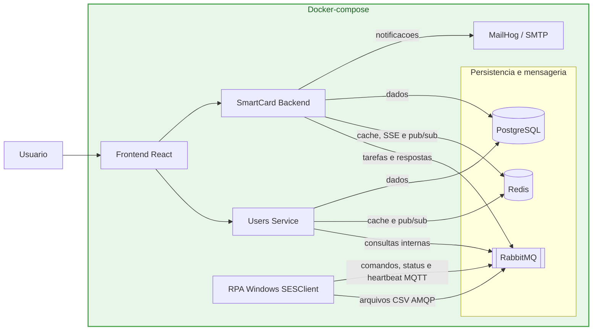

 # Lab Access

Sistema web para controle, consulta e acompanhamento de acessos ao laboratorio. A aplicacao permite enviar arquivos de registros, consultar acessos recentes ou por periodo, visualizar relatorios e graficos e acompanhar o processamento das buscas feitas automaticamente pelo RPA.

O projeto e organizado como uma arquitetura distribuida:



## Funcionalidades

- Autenticacao e autorizacao de usuarios com JWT.
- Cadastro e gerenciamento de usuarios e perfis.
- Upload e processamento de arquivos `.xls` e `.csv`.
- Consulta de registros dos ultimos cinco minutos ou por intervalo de data e hora.
- Integracao com o SESClient para extracao automatizada de registros de acesso.
- Atualizacao do status das buscas em tempo real por Server-Sent Events (SSE).
- Relatorios de ultimos acessos, acessos indevidos e status de usuarios.
- Graficos de acessos anuais e usuarios mais ativos.
- Notificacoes por e-mail em ambiente local usando MailHog.

## Tecnologias utilizadas

### Frontend

- **React 19** para a interface web.
- **TypeScript** para tipagem estatica.
- **Vite** para desenvolvimento e build.
- **React Router** para rotas da aplicacao.
- **Bootstrap** e classes utilitarias para layout e componentes visuais.
- **Chakra UI** e **Material UI** disponiveis para componentes de interface.
- **Chart.js** e **react-chartjs-2** para graficos.
- **Framer Motion** para animacoes.
- **React Loader Spinner** para indicadores de carregamento.
- **React Toastify** e **SweetAlert2** para mensagens e alertas.
- **fetch-event-source** para consumo de eventos SSE.
- **jwt-decode** para leitura de informacoes do token JWT.
- **ESLint** para analise e padronizacao do codigo.
- **Nginx** para servir os arquivos estaticos em producao.

### Backends

- **Python 3.12**.
- **Django 5.2** como framework web.
- **Django REST Framework 3.16** para APIs REST.
- **django-cors-headers** para configuracao de CORS.
- **django-htmx** para integracoes HTMX existentes.
- **django-allauth** para recursos de autenticacao.
- **Simple JWT**, **PyJWT** e `djangorestframework-simplejwt` para autenticacao baseada em tokens.
- **djangorestframework-api-key** para autenticacao por chave de API.
- **PostgreSQL** com `psycopg2-binary` como banco de dados relacional.
- **django-redis** e **redis-py** para comunicacao com Redis.
- **Celery** para tarefas assincronas.
- **django-celery-beat** para tarefas agendadas.
- **django-celery-results** para armazenamento de resultados de tarefas.
- **Pika** e **Paho MQTT** para integracao com RabbitMQ via AMQP e MQTT.
- **Pandas**, **OpenPyXL** e **xlrd** para leitura e processamento de planilhas.
- **FuzzyWuzzy**, **TheFuzz**, **RapidFuzz** e **python-Levenshtein** para comparacoes aproximadas de texto.
- **Faker** e **factory_boy** para dados e testes.
- **python-dotenv** e **python-decouple** para configuracoes por ambiente.

### RPA para Windows

- **Python** para a automacao.
- **PyAutoGUI** para controlar teclado, mouse e janelas do SESClient.
- **PyGetWindow**, **PyScreeze**, **PyMsgBox**, **MouseInfo**, **PyRect** e **PyTweening** como bibliotecas auxiliares de automacao desktop.
- **OpenCV** e **Pillow** para reconhecimento e localizacao de elementos na tela.
- **APScheduler** para execucoes agendadas a cada cinco minutos.
- **Paho MQTT** para receber buscas e publicar status, heartbeat e erros no RabbitMQ.
- **Pika** para enviar os arquivos CSV ao SmartCard via AMQP.
- **Requests** para comunicacoes HTTP.
- **Infisical** e `python-dotenv` para configuracoes e secrets.
- Logs estruturados no formato **JSONL**, armazenados em `rpa.jsonl`.

### Infraestrutura e integracao

- **Docker** e **Docker Compose** para construir e executar os servicos.
- **PostgreSQL 15** para os dados da aplicacao.
- **Redis 7** para estado temporario, pub/sub e ultima resposta do RPA.
- **RabbitMQ 3 Management** como broker de mensagens.
- **MailHog** para captura e visualizacao de e-mails em desenvolvimento.
- Comunicacao direta entre frontend e servicos backend sem API gateway.

## Estrutura do repositorio

```text
.
├── frontend/             # Aplicacao React/TypeScript
├── smartCard/            # Backend principal Django: acessos e processamento
├── users_service/        # Servico Django de usuarios
├── windows/rpa-pyauto/   # RPA Windows que controla o SESClient
├── secrets/              # Arquivos locais de secrets usados pelo Compose
├── docker-compose.yml    # Orquestracao dos servicos
├── init.sql              # Inicializacao do banco principal
└── rpa.jsonl             # Logs estruturados do RPA
```

## Portas publicadas no host

| Servico | Porta | Finalidade |
| --- | ---: | --- |
| RabbitMQ AMQP | `5672` | Comunicacao com o RPA |
| RabbitMQ MQTT | `1883` | Comandos e status do RPA |
| RabbitMQ Web MQTT | `15675` | Comunicacao MQTT via WebSocket |
| Wazuh Manager | `1514`, `1515`, `514/udp` | Comunicacao com agentes |

Frontend, APIs e paineis web sao acessados pelas rotas HTTPS do Traefik. Bancos, Redis e MailHog nao publicam portas no host.

## Fluxo de comunicacao

O frontend se comunica diretamente com os servicos de aplicacao: o backend principal em `http://localhost:8080` e o servico de usuarios em `http://localhost:8001`.

Para uma busca de registros, o backend publica no tópico MQTT `smartcard/rpa/buscar`, consumido pelo RPA Windows. O RPA acessa o SESClient e envia os arquivos CSV pela fila AMQP `csvs` (Pika), sem alterar o transporte dos arquivos. Status, heartbeat e erros do RPA são publicados por MQTT nos tópicos `smartcard/rpa/status`, `smartcard/rpa/heartbeat` e `smartcard/rpa/errors`. O backend salva o status no Redis e o disponibiliza ao frontend por consulta HTTP e SSE.

Mensageria utilizada pelo RPA:

- MQTT `smartcard/rpa/buscar`: recebe os parametros de uma busca.
- AMQP `csvs`: transporta arquivos CSV codificados em Base64.
- MQTT `smartcard/rpa/status`: informa o status e a quantidade de registros encontrados.
- MQTT `smartcard/rpa/heartbeat`: sinaliza que o RPA está ativo.
- MQTT `smartcard/rpa/errors`: envia erros do RPA ao backend.

## Como executar com Docker

### Publicacao pelo Traefik existente

O `docker-compose.yml` deste projeto nao inicia outro Traefik. Ele espera que o Traefik externo e os servicos compartilhem a rede Docker externa `traefik-public`, e que o Traefik tenha o entrypoint `websecure` e o resolver Let's Encrypt `leresolver`.

As rotas HTTPS configuradas sao:

| Servico | URL |
| --- | --- |
| Frontend | `https://dev.ana.ccs.unicamp.br/frontend/` |
| API SmartCard | `https://dev.ana.ccs.unicamp.br/smartcard/` |
| API de usuarios | `https://dev.ana.ccs.unicamp.br/users/` |
| Painel Wazuh | `https://dev.ana.ccs.unicamp.br/wazuh/` |
| Administracao RabbitMQ | `https://dev.ana.ccs.unicamp.br/rabbitmq/` |

O MailHog nao e publicado pelo Traefik. Bancos e Redis permanecem apenas na rede Docker; as portas AMQP/MQTT do RabbitMQ continuam publicadas para clientes externos, como o RPA. Antes de iniciar a stack, crie a rede externa caso ainda nao exista: `docker network create traefik-public`.

### Pre-requisitos

- Docker Desktop com Docker Compose.
- Git.
- Arquivos de secrets preenchidos em `secrets/`.
- Um arquivo `.env` na raiz quando exigido pelas configuracoes dos servicos.

Nao compartilhe nem versione secrets reais. Os arquivos em `secrets/` sao montados nos containers pelo Docker Compose.

### Subir a aplicacao

Na raiz do repositorio, execute:

```bash
docker compose up --build
```

Depois, acesse:

- Frontend: `http://localhost:3000`
- SmartCard API: `http://localhost:8080`
- Users Service: `http://localhost:8001`
- RabbitMQ Management: `http://localhost:15672`
- MailHog: `http://localhost:8025`
- Wazuh Dashboard: `https://localhost`
- Wazuh Indexer: `https://localhost:9200`
- Wazuh API: `https://localhost:56000`

O Compose principal inicia o stack Wazuh single-node (Manager, Indexer e Dashboard), usando as configuracoes e certificados de `wazuh-docker/single-node`. O host Docker precisa ter `vm.max_map_count` configurado para pelo menos `262144`, conforme os requisitos do Wazuh.

O Compose usa as credenciais padrao de desenvolvimento do Wazuh se as variaveis abaixo nao estiverem no `.env`; voce pode sobrescreve-las:

```env
WAZUH_API_USERNAME=wazuh-wui
WAZUH_API_PASSWORD=MyS3cr37P450r.*-
WAZUH_WINDOWS_AGENT_ID=001
```

O usuario e a senha sao compartilhados pelo Manager, Dashboard e backend. Essas credenciais padrao sao apenas para desenvolvimento local; use credenciais proprias e nao versione o `.env` em outros ambientes. O backend consulta o agente no Manager pela rede interna do Compose e valida o certificado TLS usando `root-ca.pem`. O endpoint do SmartCard e `GET /api/acesso/status-windows/`, acessivel a usuarios administrativos.

Para executar em segundo plano:

```bash
docker compose up --build -d
```

Para parar os containers:

```bash
docker compose down
```

## Desenvolvimento do frontend

```bash
cd frontend
npm install
npm run dev
```

Comandos disponiveis:

```bash
npm run dev      # servidor de desenvolvimento Vite
npm run build    # typecheck e build de producao
npm run lint     # verifica problemas com ESLint
npm run preview  # serve o build localmente
```

## Execucao do RPA

O RPA nao e executado pelo `docker-compose`: ele depende de uma sessao Windows com o SESClient instalado e deve rodar na maquina de automacao.

```bash
cd windows/rpa-pyauto
pip install -r requirements.txt
python main.py
```

Em uma instalacao nova, consulte [windows/README.md](windows/README.md) e os scripts de instalacao da pasta `windows/`. O RPA precisa conseguir acessar o RabbitMQ configurado e ter as imagens de referencia usadas pela automacao de tela.

## Backends Django

Cada backend possui seu proprio ambiente Python, arquivo `requirements.txt`, `manage.py`, migrations e fixtures. Os scripts `init.sh` executam a inicializacao dos respectivos servicos dentro dos containers.

Aplicativos:

- `smartCard`: gerenciamento de acessos, processamento, integracao com RPA, relatorios e notificacoes.
- `users_service`: usuarios, perfis, grupos e dados relacionados a autenticacao.

## Observacoes

- O caminho `C:/Users/anacha/Desktop/pasta` presente no Compose e especifico do ambiente original e pode precisar ser alterado em outra maquina.
- O frontend usa `http://localhost:8080` para o SmartCard e `http://localhost:8001` para o Users Service em desenvolvimento local.
- O primeiro start pode demorar porque constroi as imagens e executa migrations/fixtures.
